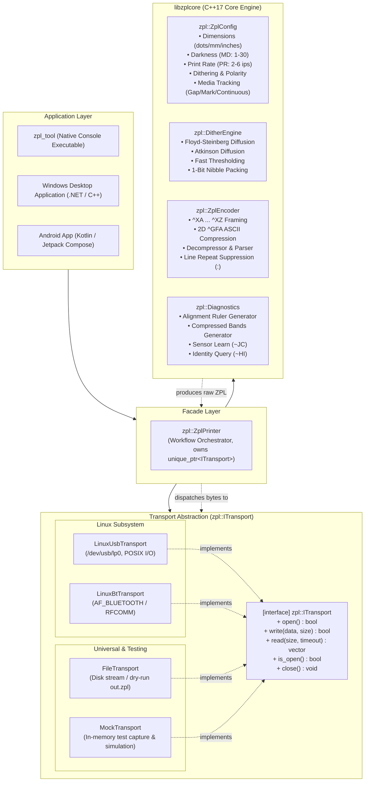

# ZPL Engine & Pluggable Transport Architecture (`libzplcore`)

A high-performance, modular, cross-platform **C++17 core engine and transport abstraction library** for generating, compressing, and transmitting Zebra Programming Language (**ZPL II**) streams.

Designed and verified against the **Milestone MHT-L1091** (Rongta V1.11 firmware, 203 DPI) thermal label printer and compatible with generic ZPL II printers.

---

## Highlights

- **Zero External Dependencies**: Core library (`libzplcore`) depends strictly on standard C++17 (`<vector>`, `<string>`, `<cstdint>`, `<memory>`).
- **High-Performance Dithering**: Native Floyd-Steinberg error diffusion, Atkinson diffusion, and fast thresholding with polarity inversion.
- **2D ZPL ASCII RLE Compression**: Full implementation of `^GFA` compression rules (`G-Y`, `g-z`, `,` blank-fill, `!` fill-ones, and `:` line repetition), shrinking graphic payloads by up to $1000\times$.
- **Bidirectional Parser & Decompressor**: Includes `decompress_row` and `decompress_gfa_payload` for verifying and parsing compressed ZPL graphic streams with 100% round-trip fidelity.
- **Pluggable Transports (`ITransport`)**:
  - **Linux USB**: Direct POSIX I/O on `/dev/usb/lp0` with `select()` read timeouts.
  - **Linux Bluetooth**: Classic RFCOMM via native `AF_BLUETOOTH` sockets without external Bluetooth libraries.
  - **File Transport**: Write-only disk export for dry-run inspection (`out.zpl`).
  - **Mock Transport**: In-memory test spy with buffer inspection and simulated response injection.
  - *Extensible for Windows (RAW print spooler) and Android NDK (JNI).*
- **Strict RAII & Ownership**: High-level `ZplPrinter` Façade uniquely owns its transport via `std::unique_ptr<ITransport>`, guaranteeing automatic resource cleanup.
- **Rich Error Diagnostics**: `PrinterError` codes and detailed error messages instead of silent boolean failures.
- **Automated GoogleTest Suite**: 24 tests across 5 isolated test suites covering config, dithering, encoding, diagnostics, and printer workflows.

---

## System Architecture



> For the comprehensive technical specification, refer to [docs/architecture.md](docs/architecture.md) or [docs/cpp-zpl-architecture.md](docs/cpp-zpl-architecture.md).

---

## Directory Structure

```text
PrinterDebug/
├── CMakeLists.txt                    # Top-level build script (core, CLI, and test suite)
├── README.md                         # Project documentation and quickstart
├── docs/                             # Design & investigation documentation
│   ├── architecture.md               # Complete architectural specification
│   ├── cpp-zpl-architecture.md       # Architectural specification copy
│   └── Milestone MHT-L1091 Printer Investigation Notes.md # Reverse-engineering notes
├── include/
│   └── zpl/
│       ├── config.hpp                # ZplConfig & unit conversion helpers
│       ├── dither.hpp                # DitherEngine & MonochromeBitmap definition
│       ├── encoder.hpp               # ZplEncoder (compression, decompression, framing)
│       ├── diagnostics.hpp           # Test label generators & hardware query commands
│       ├── transport.hpp             # Abstract ITransport interface
│       ├── printer.hpp               # High-level ZplPrinter Façade
│       ├── zpl.hpp                   # Umbrella header
│       └── transport/
│           ├── file_transport.hpp    # File-based transport
│           ├── mock_transport.hpp    # In-memory test spy transport
│           ├── linux_usb_transport.hpp # Linux /dev/usb/lpX transport
│           └── linux_bt_transport.hpp  # Linux Bluetooth RFCOMM transport
├── src/
│   ├── dither.cpp                    # Dithering algorithms implementation
│   ├── encoder.cpp                   # RLE compression & decompression implementation
│   ├── diagnostics.cpp               # Diagnostic generators implementation
│   ├── printer.cpp                   # Façade implementation
│   └── transport/
│       ├── file_transport.cpp
│       ├── mock_transport.cpp
│       ├── linux_usb_transport.cpp
│       └── linux_bt_transport.cpp
├── cli/
│   └── main.cpp                      # Command-line tool (zpl_tool)
└── tests/
    ├── test_config.cpp               # Config unit tests
    ├── test_dither.cpp               # Dithering unit tests
    ├── test_encoder.cpp              # Compression & round-trip parser tests
    ├── test_diagnostics.cpp          # Diagnostic output tests
    └── test_printer.cpp              # Printer Façade & MockTransport tests
```

---

## Building & Installation

### Requirements
- **CMake**: 3.15 or later
- **C++ Compiler**: GCC 9+, Clang 10+, or MSVC 2019+ (C++17 support required)
- **Linux Requirements**: Kernel with `usblp` driver support (for USB) and `bluez` / `AF_BLUETOOTH` (for Bluetooth)

### Build Instructions

```bash
# Clone and enter directory
cd PrinterDebug

# Create build directory
mkdir -p build && cd build

# Configure and compile
cmake ..
make -j$(nproc)
```

This builds:
- `libzplcore.a`: Static core library
- `zpl_tool`: Standalone CLI tool
- `zpl_tests`: GoogleTest runner executable

### Running Unit Tests

```bash
# Run via ctest
ctest --output-on-failure

# Or run the GoogleTest runner directly
./zpl_tests
```

---

## CLI Tool (`zpl_tool`) Usage

The CLI tool allows direct hardware testing, calibration, and label generation from the command line.

### Command Reference

```text
Usage: zpl_tool [options]

Transport Options (choose one, default: --file out.zpl):
  --usb [PATH]          Send to USB character device (default: /dev/usb/lp0)
  --bt MAC              Send to Bluetooth Classic RFCOMM MAC (e.g. 00:11:22:33:44:55)
  --file [PATH]         Write raw ZPL to file (default: out.zpl)

Action Options:
  --ruler               Print physical alignment ruler test
  --test                Print formatted diagnostic label (text, box, barcode)
  --bands               Print buffer/feed test bands
  --query               Send ~HI device identity query and read reply
  --calibrate           Send ~JC media sensor calibration command
  --raw "ZPL"           Send custom raw ZPL string

Configuration Tuning:
  --width-mm MM         Label width in mm (default: 101.6 mm / 4.00")
  --length-mm MM        Label length in mm (default: 152.4 mm / 6.00")
  --darkness N          Darkness index 1 to 30 (default: 30)
  --speed N             Print rate in inches/sec 2 to 6 (default: 2)
  --shift X             Horizontal offset in dots (^LH x, default: 0)
  --dither MODE         Dithering mode: 'floyd', 'atkinson', 'none' (default: floyd)
  --tracking MODE       Media tracking: 'continuous', 'gap', 'mark' (default: continuous)
```

### Examples

#### 1. Query Hardware Identity via USB
```bash
./zpl_tool --usb /dev/usb/lp0 --query
```
*Output:*
```text
[*] Transport: /dev/usb/lp0
[*] Config: 812x1218 dots (101x152 mm) @ 203 DPI, darkness=30
[>] Querying printer identity (~HI)...
[+] Reply: LabelPrinter,V1.11,8,0KB
[+] Operation completed successfully.
```

#### 2. Print Physical Alignment Ruler via USB
```bash
./zpl_tool --usb /dev/usb/lp0 --ruler
```

#### 3. Calibrate Media Gap/Mark Sensor
```bash
./zpl_tool --usb /dev/usb/lp0 --calibrate
```

#### 4. Print Diagnostic Barcode Label over Bluetooth
```bash
./zpl_tool --bt AA:BB:CC:DD:EE:FF --test
```

#### 5. Generate Test ZPL File (Dry Run)
```bash
./zpl_tool --file label.zpl --bands --width-mm 100 --length-mm 150
```

---

## C++ API Usage Examples

### 1. Print an 8-bit Grayscale Image over USB

```cpp
#include "zpl/zpl.hpp"
#include <iostream>
#include <memory>
#include <vector>

int main() {
    // 1. Configure for 4" x 6" label at 203 DPI (812 x 1218 dots)
    auto config = zpl::ZplConfig::from_inches(4.0f, 6.0f, 203);
    config.darkness = 30;
    config.dither = zpl::DitherMode::FloydSteinberg;

    // 2. Instantiate USB transport and Printer facade
    auto transport = std::make_unique<zpl::LinuxUsbTransport>("/dev/usb/lp0");
    zpl::ZplPrinter printer(config, std::move(transport));

    if (!printer.connect()) {
        std::cerr << "Connect failed: " << printer.last_error_message() << std::endl;
        return 1;
    }

    // 3. Prepare 8-bit grayscale pixels (0 = black, 255 = white)
    std::vector<uint8_t> pixels(812 * 1218, 255); // White canvas
    // (populate pixels with image or rendered PDF data...)

    // 4. Print (automatically dithers, compresses with ^GFA, and writes)
    if (!printer.print_image(pixels, 812, 1218)) {
        std::cerr << "Print failed: " << printer.last_error_message() << std::endl;
        return 1;
    }

    std::cout << "Label printed successfully!" << std::endl;
    return 0;
}
```

### 2. Print over Bluetooth Classic (RFCOMM)

```cpp
#include "zpl/zpl.hpp"

void print_over_bluetooth(const std::string& mac_address) {
    auto config = zpl::ZplConfig::from_mm(100.0f, 150.0f, 203);
    auto transport = std::make_unique<zpl::LinuxBtTransport>(mac_address, /*channel=*/1);
    
    zpl::ZplPrinter printer(config, std::move(transport));
    if (printer.connect()) {
        printer.print_test_label();
    }
}
```

### 3. Unit Testing with `MockTransport`

```cpp
#include "zpl/zpl.hpp"
#include <cassert>

void test_my_printing_logic() {
    zpl::ZplConfig config;
    auto mock = std::make_unique<zpl::MockTransport>();
    auto* mock_ref = mock.get();

    zpl::ZplPrinter printer(config, std::move(mock));
    assert(printer.connect());

    // Send raw or formatted label
    printer.print_raw("^XA^FDHELLO^FS^XZ");

    // Inspect captured bytes without physical hardware
    std::string captured = mock_ref->get_captured_string();
    assert(captured == "^XA^FDHELLO^FS^XZ");

    // Test simulated query responses
    mock_ref->set_simulated_read_response("LabelPrinter,V1.11,8,0KB\r\n");
    std::string reply = printer.query_identity();
    assert(reply.find("LabelPrinter") != std::string::npos);
}
```

---

## Hardware Target: Milestone MHT-L1091 Details

| Specification | Value |
|---|---|
| **OEM Hardware** | Rongta LabelPrinter (V1.11 firmware) |
| **Resolution** | 8 dots/mm = **203 DPI** |
| **Command Language** | **ZPL II only** (Silently ignores TSPL and ESC/POS) |
| **USB Identity** | `0fe6:8800` (Generic USB Bidirectional printer) |
| **Device Node** | `/dev/usb/lp0` (Linux usblp kernel driver) |
| **Identity Query (`~HI`)** | Replies with `LabelPrinter,V1.11,8,0KB` |
| **Standard 4" x 6" Label** | $812 \times 1218$ dots |

### Linux Setup Note
To write directly to `/dev/usb/lp0` without `sudo`, add your user to the `lp` group:
```bash
sudo usermod -a -G lp $USER
```
If CUPS claims the USB printer endpoint, stop the CUPS service while testing:
```bash
sudo systemctl stop cups.socket cups.service
```

---

## License

This project is licensed under the Apache License 2.0.

