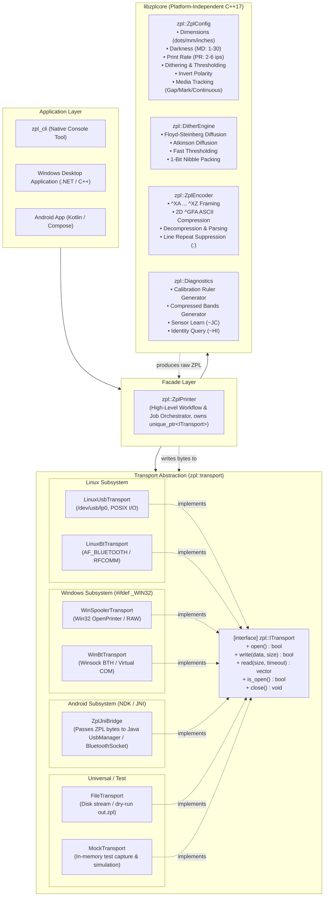

# C++ ZPL Core Engine & Pluggable Transport Architecture
## Technical Design Specification

**Document Version:** 1.1 (Updated Post-Review & Hardening)  
**Target Standard:** C++17  
**Hardware Target:** Milestone MHT-L1091 (Rongta V1.11, 203 DPI, ZPL Emulation) & Generic ZPL II Printers  
**Supported Platforms:** Linux, Windows, Android (via NDK)

---

## 1. Executive Summary & Design Principles

The objective of this architecture is to provide a high-performance, cross-platform, modular C++ library (`libzplcore`) capable of converting images, PDFs, and document primitives into optimized, compressed ZPL II byte streams, and dispatching those bytes across operating systems and transport media (USB, Bluetooth, Network, File, Memory).

### Core Principles
1. **Zero External Dependencies for Core**: The core ZPL generation, dithering, and compression engine relies strictly on standard C++17 (`<vector>`, `<string>`, `<cstdint>`, `<memory>`). It compiles on any C++17 compliant toolchain without third-party dependencies.
2. **Strict Decoupling of Generation and Transport**: The encoder has no concept of sockets, files, or USB endpoints. It operates purely as a data transformation pipeline (`Image/Bitmap` $\to$ `ZPL Byte Stream`).
3. **Pluggable & Extensible I/O**: All transport mechanisms implement an abstract interface (`ITransport`). Adding new transports requires zero changes to the core engine.
4. **Sub-Millisecond Execution**: Native C++ bit-packing and Floyd-Steinberg / Atkinson error-diffusion dithering eliminates runtime overhead, allowing instant label rasterization even on embedded or low-power mobile devices.
5. **Universal Portability (Android NDK / Windows / Linux)**: The same C++ core compiles natively on Linux and Windows, and binds directly into Android apps via a lightweight JNI wrapper without code duplication.
6. **Strict Ownership & Encapsulation**: The high-level Façade (`ZplPrinter`) uniquely owns its underlying transport via `std::unique_ptr<ITransport>`, guaranteeing unambiguous lifetime and preventing connection leaks.

---

## 2. System Architecture



---

## 3. Core Engine Specification (`libzplcore`)

### 3.1 Module: `zpl/config.hpp`
Encapsulates all printer operating parameters with unit-conversion constructors and polarity inversion.

```cpp
#pragma once
#include <cstdint>
#include <cmath>

namespace zpl {

enum class DitherMode {
    None,            // Hard thresholding (sharp text & barcodes)
    FloydSteinberg,  // Error-diffusion dithering (continuous-tone gray simulation)
    Atkinson         // High-contrast error diffusion
};

enum class MediaTracking {
    Continuous,      // ^MNN (continuous roll, no gap detection)
    WebGap,          // ^MNY (gap / notch sensing)
    BlackMark        // ^MNM (reflective black bar sensing)
};

enum class MediaType {
    DirectThermal,   // ^MTD (direct thermal, heat-sensitive paper)
    ThermalTransfer  // ^MTT (ribbon transfer)
};

struct ZplConfig {
    int dpi = 203;                  // Hardware resolution: 203 DPI (8 dots/mm)
    int width_dots = 812;           // Active width (default: 4.00" = 812 dots)
    int length_dots = 1218;         // Active length (default: 6.00" = 1218 dots)
    int darkness = 30;              // Heat burn duration (1 - 30, ^MD / ~SD)
    int print_speed = 2;            // Print rate in inches/sec (2 - 6, ^PR)
    int shift_x = 0;                // Horizontal origin offset in dots (^LH)
    int shift_y = 0;                // Vertical origin offset in dots (^LH)

    DitherMode dither = DitherMode::FloydSteinberg;
    uint8_t threshold = 140;        // Cutoff value (0-255) for DitherMode::None
    bool invert = false;            // Invert polarity (white-on-black)
    MediaTracking tracking = MediaTracking::Continuous;
    MediaType media_type = MediaType::DirectThermal;

    // Unit conversion factories
    static ZplConfig from_mm(float width_mm, float length_mm, int dpi = 203) {
        ZplConfig cfg;
        cfg.dpi = dpi;
        cfg.width_dots = static_cast<int>(std::round(width_mm * (static_cast<float>(dpi) / 25.4f)));
        cfg.length_dots = static_cast<int>(std::round(length_mm * (static_cast<float>(dpi) / 25.4f)));
        return cfg;
    }

    static ZplConfig from_inches(float width_in, float length_in, int dpi = 203) {
        ZplConfig cfg;
        cfg.dpi = dpi;
        cfg.width_dots = static_cast<int>(std::round(width_in * static_cast<float>(dpi)));
        cfg.length_dots = static_cast<int>(std::round(length_in * static_cast<float>(dpi)));
        return cfg;
    }

    float width_mm() const {
        return static_cast<float>(width_dots) / (static_cast<float>(dpi) / 25.4f);
    }

    float length_mm() const {
        return static_cast<float>(length_dots) / (static_cast<float>(dpi) / 25.4f);
    }

    float width_inches() const {
        return static_cast<float>(width_dots) / static_cast<float>(dpi);
    }

    float length_inches() const {
        return static_cast<float>(length_dots) / static_cast<float>(dpi);
    }
};

} // namespace zpl
```

---

### 3.2 Module: `zpl/dither.hpp`
Converts 8-bit grayscale bitmap data into 1-bit packed binary data (where `1` bit = burn/black dot, `0` bit = unburned/white dot).

```cpp
#pragma once
#include <vector>
#include <cstdint>
#include "zpl/config.hpp"

namespace zpl {

struct MonochromeBitmap {
    int width = 0;
    int height = 0;
    int bytes_per_row = 0;              // (width + 7) / 8
    std::vector<uint8_t> data;         // 1 bit per pixel, MSB first

    size_t total_bytes() const {
        return data.size();
    }
};

class DitherEngine {
public:
    static MonochromeBitmap process(
        const uint8_t* gray_pixels,
        int width,
        int height,
        const ZplConfig& config
    );

    static MonochromeBitmap process(
        const std::vector<uint8_t>& gray_pixels,
        int width,
        int height,
        const ZplConfig& config
    ) {
        if (width <= 0 || height <= 0 ||
            gray_pixels.size() < static_cast<size_t>(width) * static_cast<size_t>(height)) {
            return MonochromeBitmap{};
        }
        return process(gray_pixels.data(), width, height, config);
    }
};

} // namespace zpl
```

---

### 3.3 Module: `zpl/encoder.hpp` & ZPL Compression / Parsing
The encoder packages monochrome bitmaps into ZPL II format and includes full round-trip decompressor/parser facilities.

```cpp
#pragma once
#include <string>
#include <vector>
#include "zpl/config.hpp"
#include "zpl/dither.hpp"

namespace zpl {

class ZplEncoder {
public:
    // Generate complete ZPL job for an image
    static std::string encode_image(
        const MonochromeBitmap& bitmap,
        const ZplConfig& config,
        bool compress = true
    );

    // Compress raw bitmap bytes into ^GFA payload string
    static std::string compress_gfa_payload(
        const uint8_t* data,
        size_t total_bytes,
        int bytes_per_row
    );

    // Row-level run-length encoder
    static std::string compress_row(const std::string& hex_row);

    // Row-level run-length decompressor / parser
    static std::string decompress_row(
        const std::string& compressed_row,
        size_t expected_hex_len
    );

    // Decompress a full ZPL ^GFA payload back into binary bytes
    static std::vector<uint8_t> decompress_gfa_payload(
        const std::string& payload,
        size_t total_bytes,
        int bytes_per_row
    );

    static std::string to_hex_string(const uint8_t* data, size_t length);
    static std::vector<uint8_t> from_hex_string(const std::string& hex);
    static std::string build_preamble(const ZplConfig& config);
};

} // namespace zpl
```

---

### 3.4 Module: `zpl/diagnostics.hpp`
Provides standalone test generators for hardware calibration without requiring image assets.

```cpp
#pragma once
#include <string>
#include "zpl/config.hpp"

namespace zpl {

class Diagnostics {
public:
    static std::string generate_ruler(const ZplConfig& config);
    static std::string generate_bands(const ZplConfig& config);
    static std::string generate_test_label(const ZplConfig& config);
    static std::string query_identity() { return "~HI\r\n"; }
    static std::string calibrate_sensor() { return "~JC\r\n"; }
};

} // namespace zpl
```

---

## 4. Transport Abstraction Layer (`zpl::transport`)

```cpp
#pragma once
#include <cstdint>
#include <vector>
#include <string>
#include <chrono>

namespace zpl {

class ITransport {
public:
    virtual ~ITransport() = default;

    virtual bool open() = 0;
    virtual void close() = 0;
    virtual bool is_open() const = 0;

    virtual bool write(const uint8_t* data, size_t size) = 0;
    
    bool write(const std::string& text) {
        return write(reinterpret_cast<const uint8_t*>(text.data()), text.size());
    }

    bool write(const std::vector<uint8_t>& bytes) {
        return write(bytes.data(), bytes.size());
    }

    virtual std::vector<uint8_t> read(
        size_t max_bytes = 1024,
        std::chrono::milliseconds timeout = std::chrono::milliseconds(1000)
    ) = 0;

    virtual std::string get_endpoint_name() const = 0;
};

} // namespace zpl
```

Supported Transports:
- **`LinuxUsbTransport`**: `/dev/usb/lpX` with POSIX I/O and `select()`.
- **`LinuxBtTransport`**: Bluetooth Classic RFCOMM via native `AF_BLUETOOTH` sockets.
- **`FileTransport`**: Dedicated stream writer for disk dry-run (`out.zpl`).
- **`MockTransport`**: In-memory test spy with capture inspection and query simulation.
- **`WinSpoolerTransport`** (`#ifdef _WIN32`): Win32 `winspool.drv` RAW write.
- **`WinBtTransport`** (`#ifdef _WIN32`): Virtual COM / Winsock BTH.

---

## 5. High-Level Facade: `zpl::ZplPrinter`

```cpp
#pragma once
#include <memory>
#include <string>
#include <vector>
#include <chrono>

#include "zpl/config.hpp"
#include "zpl/transport.hpp"
#include "zpl/dither.hpp"
#include "zpl/encoder.hpp"
#include "zpl/diagnostics.hpp"

namespace zpl {

enum class PrinterError {
    None,
    NoTransport,
    ConnectionFailed,
    WriteFailed,
    ReadTimeout,
    InvalidData
};

class ZplPrinter {
public:
    explicit ZplPrinter(ZplConfig config, std::unique_ptr<ITransport> transport = nullptr);
    ~ZplPrinter();

    bool connect();
    void disconnect();
    bool is_connected() const;

    bool print_raw(const std::string& raw_zpl);
    bool print_raw(const uint8_t* data, size_t size);

    bool print_image(const uint8_t* grayscale_pixels, int width, int height);
    bool print_image(const std::vector<uint8_t>& grayscale_pixels, int width, int height);
    bool print_monochrome(const MonochromeBitmap& bitmap);

    bool print_alignment_ruler();
    bool print_bands_test();
    bool print_test_label();

    std::string query_identity(std::chrono::milliseconds timeout = std::chrono::milliseconds(1000));
    bool calibrate_sensor();

    void set_config(const ZplConfig& config) { config_ = config; }
    const ZplConfig& get_config() const { return config_; }

    ITransport* get_transport() const { return transport_.get(); }
    void set_transport(std::unique_ptr<ITransport> transport);

    PrinterError last_error() const;
    std::string last_error_message() const;

private:
    ZplConfig config_;
    std::unique_ptr<ITransport> transport_;
    PrinterError last_error_ = PrinterError::None;
    std::string last_error_msg_;
};

} // namespace zpl
```

---

## 6. Directory Layout & GoogleTest Infrastructure

```
PrinterDebug/
├── CMakeLists.txt
├── README.md
├── docs/
│   ├── architecture.md
│   └── cpp-zpl-architecture.md
├── include/
│   └── zpl/
│       ├── config.hpp
│       ├── dither.hpp
│       ├── encoder.hpp
│       ├── diagnostics.hpp
│       ├── transport.hpp
│       ├── printer.hpp
│       ├── zpl.hpp
│       └── transport/
│           ├── file_transport.hpp
│           ├── mock_transport.hpp
│           ├── linux_usb_transport.hpp
│           └── linux_bt_transport.hpp
│
├── src/
│   ├── dither.cpp
│   ├── encoder.cpp
│   ├── diagnostics.cpp
│   ├── printer.cpp
│   └── transport/
│       ├── file_transport.cpp
│       ├── mock_transport.cpp
│       ├── linux_usb_transport.cpp
│       └── linux_bt_transport.cpp
│
├── cli/
│   └── main.cpp
│
└── tests/
    ├── test_config.cpp
    ├── test_dither.cpp
    ├── test_encoder.cpp
    ├── test_diagnostics.cpp
    └── test_printer.cpp
```

